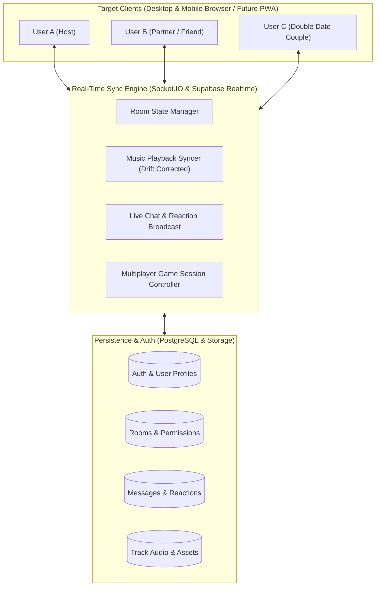

# CoupleSync - Product & Engineering Phases Roadmap

> **Vision**: *"Same vibes, different places."*  
> A dedicated social sync platform where couples and close friends can hang out in private synchronized rooms — listening to music together, playing interactive multiplayer games, and chatting in real-time.

---

## Architecture Overview



---

## Phase Roadmap Matrix

| Phase | Milestone Name | Key Deliverables | Status |
|---|---|---|---|
| **Phase 0** | **Interactive MVP Monorepo** | Working React + Node/Socket.io web app, Room creation/join via code, Real-time synced audio player, Instant live chat with floating reactions, 3 couple multiplayer games (Quiz, Truth or Dare, Would You Rather). | 🟢 **ACTIVE / COMPLETED** |
| **Phase 1** | **Persistent Auth & Supabase RLS** | User accounts (Email/Password & Social OAuth), persistent user profiles, Room history, Row Level Security (RLS) ensuring strict private room access. | 🟡 Upcoming |
| **Phase 2** | **Full Audio Streaming & Integrations** | Synchronized YouTube Player IFrame API, Spotify Web Playback SDK integration, shared dynamic queue management, and advanced millisecond NTP clock drift correction. | 🟡 Planned |
| **Phase 3** | **Expanded Game Room (Ludo & UNO)** | Canvas-based Turn-based 2-4 player Ludo board, UNO-style card game engine, custom "How Well Do You Know Me?" quiz creator. | 🟡 Planned |
| **Phase 4** | **WebRTC Voice & Video Hangout** | Low-latency peer-to-peer or SFU (LiveKit) video/audio calls with romantic floating filters, mute/cam toggles, screen share for watching movies together. | 🟡 Planned |
| **Phase 5** | **Mobile App (Android / iOS)** | Installable Progressive Web App (PWA) with push notifications, followed by Capacitor / React Native wrapper for Google Play Store release. | 🟡 Planned |
| **Phase 6** | **Scale, Moderation & Security** | End-to-end encrypted chat, rate limiting, room moderation tools (kick/mute), Redis-backed socket adapter for horizontal multi-server scaling. | 🟡 Planned |

---

## Detailed Phase Breakdown

### 🎯 Phase 0: Working MVP Core (Current Milestone)
- **Monorepo Setup**: Root workspace managing `apps/client` (Vite + React) and `apps/server` (Express + Socket.io).
- **Room Management**:
  - Instant Room Creation with randomized friendly room code (e.g., `LOVE-4821`, `VIBE-9912`).
  - Join via 6-digit code or direct link with query parameter (`?room=XYZ`).
  - Live member presence tracking (`host`, `partner`, `guest`) with real-time join/leave toast notifications.
- **Synchronized Music Experience**:
  - Built-in curated romantic, lofi chill, and pop music playlist with real streaming audio.
  - Authoritative room playback state: `isPlaying`, `trackId`, `positionMs`, `lastUpdated`.
  - When either partner clicks Play, Pause, Seek, or Next, both devices instantly update in lockstep.
  - Interactive scrub bar, volume controller, and live visualizer animation.
- **Real-Time Live Chat**:
  - Instant socket-based message delivery with timestamps and sender badges.
  - Quick emoji reactions and floating heart/love particle animations triggering on both screens simultaneously.
- **Multiplayer Games Module**:
  - **Game 1: Truth or Dare (Couples & Friends Edition)**: Interactive turn rotation with romantic, funny, deep, and spicy prompt decks.
  - **Game 2: Couple Quiz ("Who Knows Who Better?")**: Real-time synchronized multiple-choice rounds with score tallying.
  - **Game 3: Would You Rather (Couples Edition)**: Synchronized card reveal where both partners make choices and percentages show compatibility.
- **Design & UX**:
  - Deep violet / indigo aesthetic (`#0a0818` background, `#14102c` card surface, `#6366f1` indigo accent, `#ec4899` pink glow).
  - Responsive mobile-first layout with smooth tab transitions and glassmorphism.

---

### 🔐 Phase 1: Authentication & PostgreSQL Database
- **Supabase / PostgreSQL Integration**:
  - `profiles`: id, display_name, avatar_url, bio, anniversary_date, created_at.
  - `rooms`: id, code, name, host_id, capacity, is_private, passcode, status.
  - `room_members`: room_id, user_id, role (host/member), joined_at.
  - `messages`: id, room_id, user_id, content, reactions, created_at.
  - `playback_state`: room_id, provider, track_id, position_ms, is_playing, updated_at.
- **Row Level Security (RLS)**:
  - Strict policies ensuring non-members cannot read room messages or join private password-protected rooms without authorization.
- **User Profiles**: Custom couple avatars, nicknames, and customizable themes.

---

### 🎵 Phase 2: Expanded Streaming & High-Accuracy Sync
- **YouTube IFrame API & Spotify Web API Integration**:
  - Embedded player supporting millions of tracks.
  - Fallback to royalty-free / user audio URLs if third-party embed policies restrict mobile autoplay.
- **NTP Drift Correction Algorithm**:
  - Server clock timestamping (`serverTime`) passed in sync payloads.
  - Client measures Round Trip Time (`RTT = (t1 - t0) / 2`) and calculates time offset:
    ```
    deltaT = t_client - (t_server + RTT)
    ```
  - Auto-seeks only if drift exceeds 1.5 seconds to prevent jarring audio stutters.
- **Shared Queue**: Collaborative playlist where both partners can add tracks, upvote, and reorder.

---

### 🎲 Phase 3: Advanced Multiplayer Board & Card Games
- **Ludo Multiplayer**:
  - 2-4 player virtual Ludo board with animated dice rolls and piece movement validation on the server.
- **Couple Card Games**:
  - UNO-style card gameplay with romantic action cards (e.g. "Steal a Kiss", "Skip Your Turn for a Hug").
- **Custom Quiz Builder**:
  - Partners can craft custom questions for each other beforehand and reveal answers live.

---

### 📹 Phase 4: WebRTC Voice & Video Hangout
- **Low-Latency Video Chat**:
  - WebRTC mesh (for 2 users) or LiveKit SFU (for 4+ users).
  - Picture-in-picture floating video bubbles so partners can see each other's expressions while browsing music and playing games.
- **Watch Together**:
  - Synchronized video streaming / screen sharing capabilities.

---

### 📱 Phase 5: Mobile App (PWA & Android App)
- **Progressive Web App (PWA)**:
  - `manifest.json`, Service Workers for offline caching and instant loading.
  - Web Push notifications for room invites ("Your partner started a hangout!").
- **Android App Store Packaging**:
  - Capacitor / TWA (Trusted Web Activity) package for native Google Play Store listing.
  - Hardware audio notification background playback controls.

---

### 🛡️ Phase 6: Production Polish, Moderation & Scalability
- **Security & Moderation**:
  - Host kick/ban controls, message rate-limiting, profanity filtering.
  - Ephemeral chat auto-clearing option.
- **High-Concurrency Scaling**:
  - Redis pub/sub adapter for Socket.IO allowing horizontal server scaling across multiple nodes.
  - CDN edge caching for static assets.
